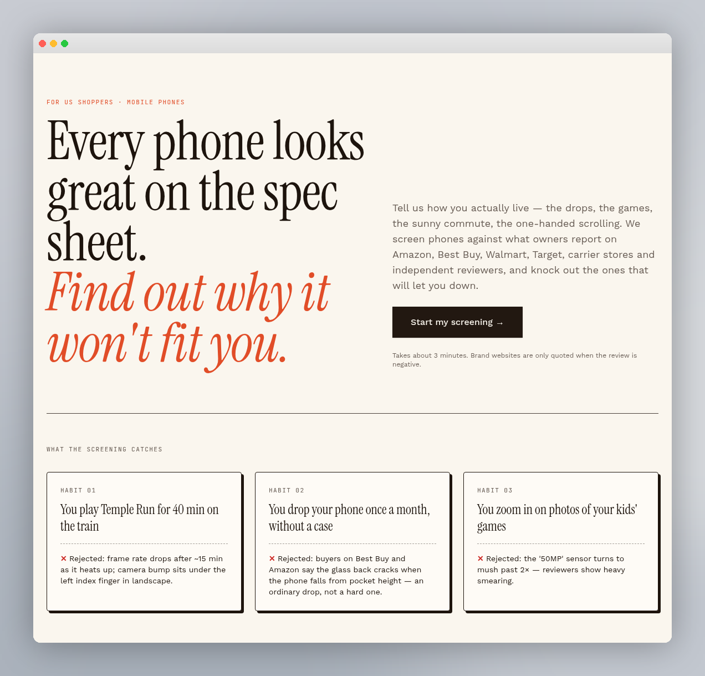
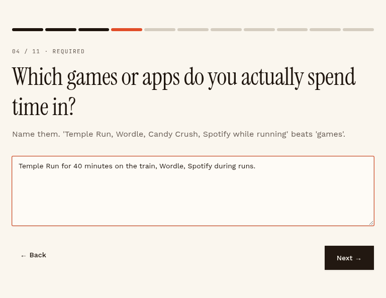
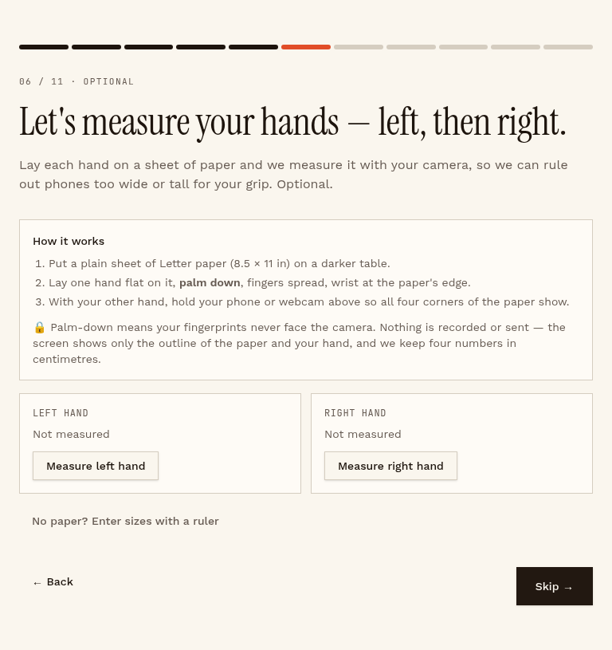
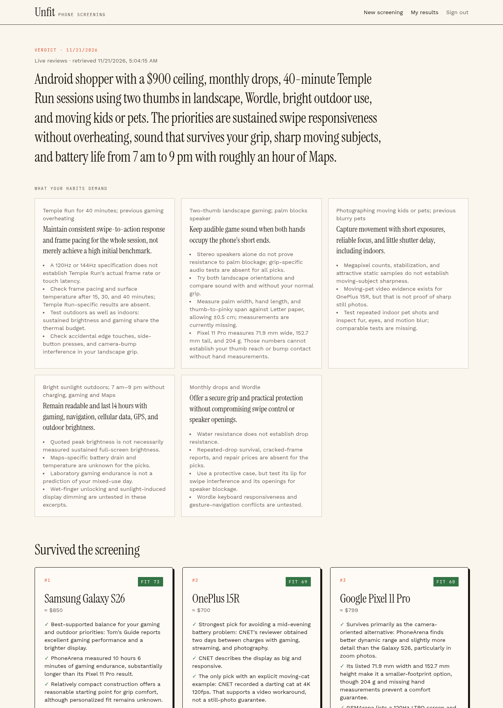
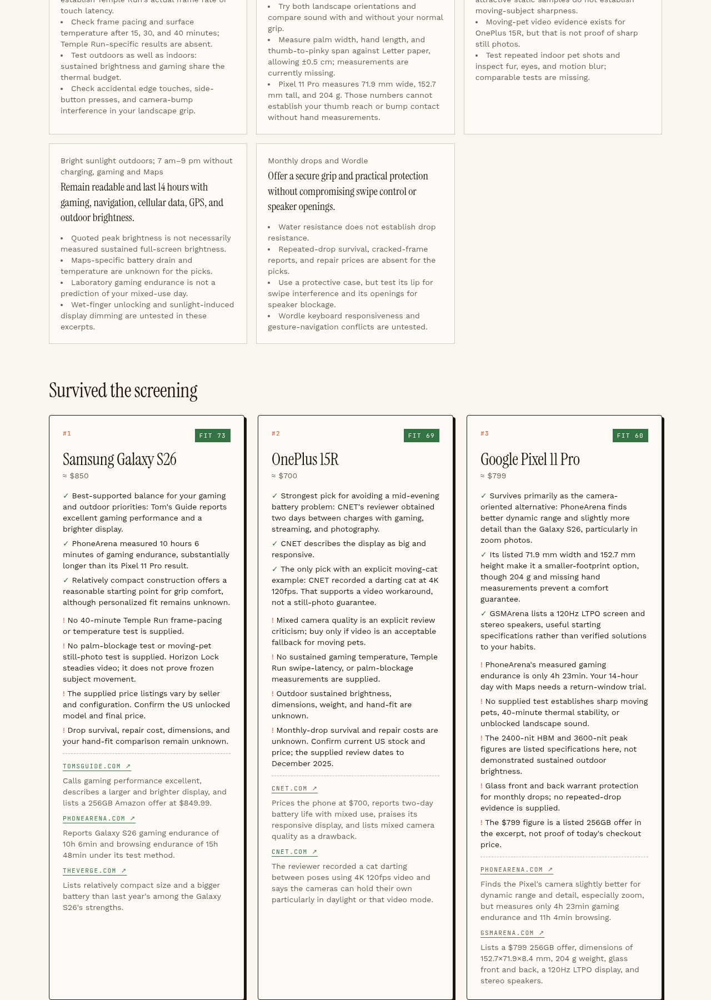

# Unfit

**Screen out the wrong phone before choosing the right one.**

Unfit turns real habits into specific reasons a phone might fail a shopper: long Temple Run sessions, frequent drops, one-handed scrolling, moving kids in photos, and a full day away from a charger. A US-market web prototype built with Lovable.

[Live app](https://relevantbuy.lovable.app) · [Setup](docs/SETUP.md) · [Architecture](docs/ARCHITECTURE.md) · [GitHub showcase guide](docs/SHOWCASE.md)



## Watch it work

- **[Trailer](videos/unfit_trailer_v4.mp4):** higher-pitched narration with heavy music kept quiet under speech.
- **[README walkthrough](videos/unfit_readme_walkthrough_v2.mp4):** higher-pitched narration explaining live-review screening, with a quiet, light instrumental bed.

The MP4s are separate companion downloads, not inside the source ZIP. Add them to `videos/` beside this README, or upload them as GitHub attachments and replace these links. Inline playback depends on GitHub attachment support.

## What makes it different

- **Habits, not a generic spec checklist.** Eleven questions cover budget, platform, drops, named apps, holding style, optional hand measurement, camera use, environment, charging, annoyances, and how a great phone would *function*.
- **Dealbreakers first.** Checks include grip, uneven weight, camera bumps, speaker blockage, long-session heating, swipe friction, shutter lag and zoom degradation.
- **Explain the decision.** Functional demands, three ranked survivors with caveats, and rejected phones with habit-specific reasons.
- **Save privately.** Signed-in shoppers can revisit their own screenings.
- **Optional local hand sizing.** Left and right hands are measured one at a time, palm down on Letter paper; manual ruler entry is available. Camera frames stay in the browser; numerical sizes are submitted with answers.

## A quick tour

| Specific habits | Optional hand sizing |
| --- | --- |
|  |  |





The live screenshots come from a signed-in demonstration screening, not independent product testing or purchase endorsements. The cover and older result screenshots in `docs/images/` predate live-review integration.

## Important limitations

**Live review excerpts, AI fit reasoning.** New screenings fetch public review excerpts through Parallel, cite at least five non-brand domains, and save source URLs, excerpts and a retrieval timestamp. Citation URLs must match retrieved pages; insufficient coverage fails rather than falling back to model knowledge. Brand sites are excluded altogether. AI interpretations are not independently verified, and retrieval today does not mean a review was published today. Missing habit-specific evidence remains uncertain. Older saved screenings retain their original model-knowledge evidence and are labeled accordingly.

Hand sizing estimates grip fit; it does **not** directly measure phone-holding circumference. Letter-paper calibration and steady-frame averaging are implemented, but accuracy and repeatability on real hands have not been validated. The displayed tolerance is not a certified accuracy claim. Keep palms down to avoid presenting fingerprints. No fingerprint recognition is implemented. Model/WASM files download from external hosts, but camera images are not uploaded by the app.

Scores and prices are AI estimates, not laboratory results or live offers. Verify prices, durability, camera performance and comfort before buying. Native iPhone/Android apps are not included.

## Run locally

Use a recent Bun release and your own configured service environment:

```sh
bun install --frozen-lockfile
cp .env.example .env
# Fill in your own environment values before starting.
bun run dev
```

Sign-in, saved results and screening require configured Lovable Cloud services and server-side AI access. The archive includes schema/migrations, **not** hosted data, accounts, sessions, secrets or a running backend. See [setup](docs/SETUP.md) for prerequisites and deployment limitations.

```sh
bun run test
bun run build
```

## Technology

React 19 · TypeScript · TanStack Start/Router · TanStack Query · Vite · Tailwind CSS v4 · shadcn/Radix · Lovable Cloud · Lovable AI Gateway · MediaPipe Hand Landmarker

The lockfile is authoritative for resolved versions. The existing server target is Worker-compatible.

```text
src/routes/                   Pages, authentication gate and metadata
src/components/               Questionnaire, screening animation, hand sizing
src/lib/questions.ts          Habit questions and answer validation
src/lib/research.functions.ts  Authenticated screening and persistence
src/lib/liveReviews.server.ts Parallel live-review retrieval
src/lib/liveReviews.ts        Citation and source-coverage validation
src/lib/handMeasure.ts         Paper detection and measurement geometry
src/integrations/             Generated service clients and middleware
drizzle/                     Schema and migration history
docs/                        Setup, architecture and showcase images
```

## Verification and licensing

Eleven live-review, geometry and routing tests passed. A fresh signed-in live screening returned three picks, rejections and 16 citation links across six sites; its retrieval date and results survived reload. This is not a real-hand accuracy validation or review reliability audit.

The export excludes environment files, repository history, dependencies, caches, build output and hosted user data. No open-source license has been selected; choose one before granting reuse rights. Third-party dependencies retain their own licenses.
